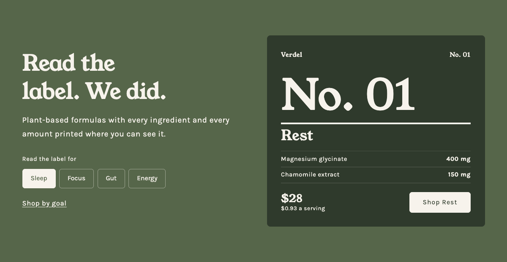

# Verdel

A Shopify theme for Verdel, a made-up supplement brand. Its one promise is that every ingredient and every amount is printed where you can see it, so the theme is built around the label. Built on Dawn 16 and running on a password-protected demo store.



## What it does

**Label hero.** The home page opens on a formula's real label: ingredients, amounts, price and price per serving. Goal tabs (Sleep, Focus, Gut, Energy) switch between formulas. Everything on the label comes from product and variant metafields, so it changes when the product does.

**Find your formulas quiz.** A three-question quiz that ends with two or three formulas. I kept the scoring in a plain JavaScript module, away from the page, so it could have unit tests. Answers live in the URL, so a shared link opens the same result. Shopify renders the result through the Section Rendering API, and the whole set goes into the bag in one click.

**Bag.** The cart drawer was rebuilt around how supplements are bought:
- a subscribe toggle on each line, using selling plans
- live free shipping status: free on US orders over $50, or when everything in the bag is a subscription
- a warning when two formulas share an ingredient, or when a formula may overlap with a multivitamin

Every change goes through the Cart AJAX API and redraws the bag from Liquid without a page reload.

**Bundle discount.** 10% off when the bag holds two or more different formulas bought once. It runs as a Shopify Function in a separate app, [verdel-stack-discount](https://github.com/AlinaDev252/verdel-stack-discount). Subscriptions already save 15%, so they don't get it. B2B buyers don't either.

The product page also has a sticky buy bar and a second formula to add, picked per product in a metafield. The rest of the store has a subscription page, ingredient stories, an FAQ and one icon set drawn on a single fine stroke.

## Scores

Lighthouse, mobile, Chrome DevTools in Incognito, live store, 24 November 2026.

| Page | Performance | Accessibility | Best practices | SEO |
| --- | --- | --- | --- | --- |
| Home | 95 | 100 | 100 | 100 |
| Product | 94 | 100 | 100 | 100 |
| Find your formulas (quiz) | 85 | 100 | 100 | 100 |

Product structured data passes Google's Rich Results Test for product snippets and merchant listings. Demo reviews are left out of it on purpose, so no star ratings reach search.

## Demo content

Verdel is not a real brand. Products, prices, reviews and testing claims are fictional, and the store footer says so.

## Working on it

```sh
shopify theme dev --store <your-store>
node --test
```

Theme Check runs on every push ([theme-check.yml](.github/workflows/theme-check.yml)). The quiz scoring tests live in [test/](test/).

## Built on Dawn

Verdel starts from [Dawn](https://github.com/Shopify/dawn) 16.0.0 by Shopify, used under its [license](LICENSE.md).
